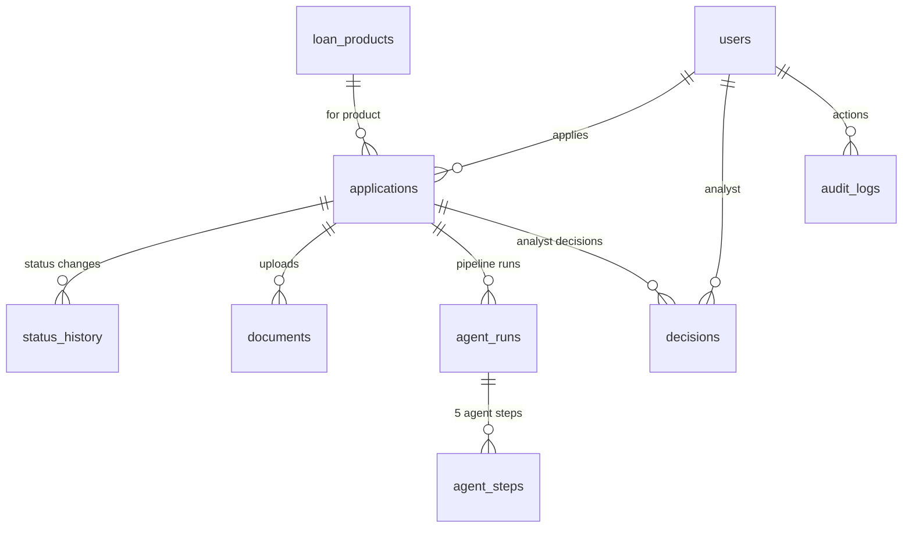
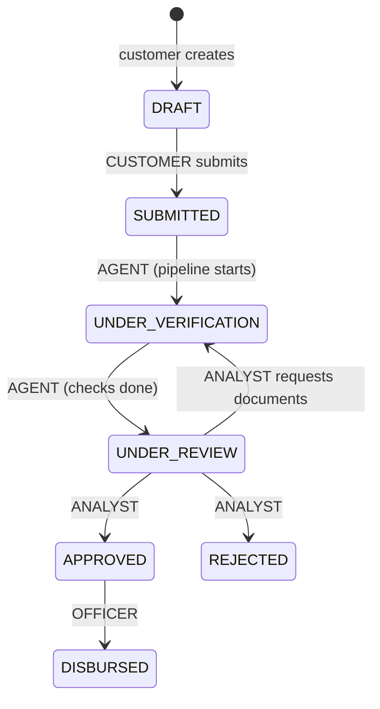

# LoanLens AI: End-to-End Workflow and Data Map

This document follows a loan application from login to approval and shows, for every step, **which API is called, which tables are read or written, and what lands in the audit log**.

- **Database:** Supabase Postgres + pgvector (10 tables, created by `Base.metadata.create_all`)
- **Files:** uploaded documents are stored on disk in `backend/uploads/<application_id>/`
- **Not stored anywhere:** EMI calculations (pure maths, computed on request)

---

## 1. The 10 tables at a glance

| Table | What it holds | Written by | Read by |
|---|---|---|---|
| `users` | Demo users, role, segment, income, existing EMI, masked PAN | Seed | Login, advisor (profile), agent tools, analyst screens |
| `loan_products` | The 8 loan products with rate, tenure and amount ranges, fees, min credit score, tags | Seed | Products page, advisor, applications, agent tools |
| `policy_chunks` | One row per policy section, with metadata (version, effective date, audience) and a 384-dim **embedding** | Seed (ingest) | RAG policy answers, compliance agent |
| `applications` | One row per loan application: amount, tenure, declared income, **status**, **version** | Customer create, state machine | Almost every screen |
| `status_history` | Every status change: from → to, who (role) and a note | State machine (`set_status`) | Customer timeline |
| `documents` | Uploaded document metadata (type, file name, path on disk) | Customer upload | Document agent, detail screens |
| `agent_runs` | One row per pipeline run: status, recommendation, risk band, full result JSON | Agent pipeline | Detail screens, analyst queue |
| `agent_steps` | One row per agent inside a run (5 per run), with the tool calls it made | Agent pipeline | Analyst review page |
| `decisions` | Human analyst decisions with the required comment | Analyst | Customer detail (analyst's note) |
| `audit_logs` | Every important action, PII-masked, with request ID and SUCCESS/DENIED/BLOCKED/ERROR | Everywhere | Security review (Supabase Table Editor) |

### Key columns

**`users`:** `id, email (unique), password_hash (bcrypt), full_name, role (CUSTOMER|OFFICER|ANALYST), segment (SALARIED|SELF_EMPLOYED|STUDENT), monthly_income, existing_emi, pan_masked, created_at`.
There are no gender, religion, caste, marital-status or age columns, by design.

**`loan_products`:** `id (e.g. VL-204), name, loan_type, description, rate_min, rate_max, tenure_min, tenure_max, amount_min, amount_max, processing_fee_pct, eligible_segments (JSONB), min_credit_score, tags (JSONB)`

**`policy_chunks`:** `id, doc_key, doc_title, section, content, version, effective_date, loan_type, doc_type, customer_segment, audience (CUSTOMER|INTERNAL), embedding vector(384)`

**`applications`:** `id, user_id → users, product_id → loan_products, amount, tenure_months, declared_income, purpose, status, version, created_at, updated_at`.
The customer-facing ID is computed as `LA-2026-{id:05d}`, e.g. `LA-2026-00001`.

**`status_history`:** `id, application_id → applications, from_status, to_status, actor_role (CUSTOMER|AGENT|ANALYST|OFFICER), note, created_at`

**`documents`:** `id, user_id, application_id, doc_type (IDENTITY|ADDRESS|INCOME), file_name, file_path, uploaded_at`

**`agent_runs`:** `id, application_id, status (RUNNING|COMPLETED|FAILED), recommendation, risk_band, requires_human_approval (always true), result_json (JSONB), created_at`

**`agent_steps`:** `id, run_id → agent_runs, step_order, agent_name, result, detail, tool_calls (JSONB), created_at`

**`decisions`:** `id, application_id, analyst_id → users, decision (APPROVE|REJECT|REQUEST_DOCUMENTS), comment (required), created_at`

**`audit_logs`:** `id, request_id, user_id, actor (e.g. user:1, agent:CreditAssessmentAgent, role:AGENT), action, entity (e.g. application:1), input_masked (JSONB), output (JSONB), status (SUCCESS|DENIED|BLOCKED|ERROR), created_at`

### Relationships



`policy_chunks` stands alone: it is the RAG knowledge base.

---

## 2. Application status lifecycle



- Every change goes through **`set_status()`** (`backend/app/core/status.py`). Each successful change:
    1. updates `applications.status`, increments `applications.version` and sets `updated_at`, in one atomic conditional `UPDATE … WHERE status = current AND version = expected`
    2. inserts a `status_history` row
    3. inserts an `audit_logs` row with action `STATUS_CHANGE`
    4. commits once
- A transition that isn't in the table (for example an **agent trying to set APPROVED**) is refused with `409 INVALID_TRANSITION` and logged as `STATUS_CHANGE_DENIED / DENIED`.
- If the version doesn't match (someone else changed it first), the request gets `409 STALE_VERSION` and nothing is written.

---

## 3. Step-by-step workflow (demo path)

Example: **Priya** applies for a ₹5,00,000 used-car loan, skips the address proof, the analyst asks for it, she uploads it, and the analyst approves.

### Step 0: Seed (setup, once)
`python -m app.seed --reset`

| Table | Write |
|---|---|
| all | `DROP` then `CREATE` all 10 tables (+ `CREATE EXTENSION vector`) |
| `users` | 4 rows: Priya, Rahul, Officer, Analyst (bcrypt password hashes) |
| `loan_products` | 8 rows: PL-101 … EL-402 |
| `policy_chunks` | 30 rows: each `## section` of the 7 Markdown files in `backend/policies/`, with embeddings from local fastembed (`BAAI/bge-small-en-v1.5`) |

> `--reset` wipes all data. Never run it during a demo, and remember that anyone sharing the same `.env` shares the same database.

### Step 1: Login
`POST /api/v1/auth/login`

| Table | Read / write |
|---|---|
| `users` | **read** by email, then bcrypt password check |
| `audit_logs` | **write** `LOGIN / SUCCESS` or `LOGIN_FAILED / DENIED` (masked email) |

Returns a JWT (HS256) with `sub = user id`, `role`, and `exp` (`JWT_EXPIRE_MINUTES`, currently 30). The frontend stores it in `localStorage["loanlens_token"]` and sends it as `Authorization: Bearer …` on every request. `GET /auth/me` reads `users`.

### Step 2: Browse products and EMI
- `GET /products` reads `loan_products` (filter, search and sort run in Python). Nothing is written.
- `POST /emi/calculate`, `POST /emi/what-if`: **no database access**. These are pure `Decimal` maths in `services/emi.py`.

### Step 3: AI Advisor
`POST /api/v1/advisor/chat` (customer only)

| Order | What happens | Tables |
|---|---|---|
| 1 | Injection guard. If blocked: 400 | `audit_logs` write `INJECTION_BLOCKED / BLOCKED` |
| 2 | PII masked, then the LLM (Groq) **extracts** loan type, amount, income and max EMI. It does no maths | none |
| 3 | Missing income or existing EMI are taken from the profile | `users` read |
| 4 | Matching products by type, amount range and segment, ranked by tag match | `loan_products` read |
| 5 | EMI, FOIR and eligibility computed in code | none |
| 6 | Log the request | `audit_logs` write `ADVISOR_CHAT` (masked message, recommended product IDs) |

Recommendations are **not stored**. They are returned to the screen only.

### Step 4: Policy Help (RAG)
`POST /api/v1/rag/ask` (any role)

| Order | What happens | Tables |
|---|---|---|
| 1 | Injection guard + PII masking | `audit_logs` `INJECTION_BLOCKED` if blocked |
| 2 | Question embedded locally (384-dim) | none |
| 3 | One SQL query: keep only the **latest effective version** of each document, filter `audience` by role (customers see only `CUSTOMER`), rank by cosine similarity, take the top 4 | `policy_chunks` read |
| 4 | If the top score < `RAG_MIN_SCORE` (0.55), give the safe reply. Otherwise the LLM answers **only from those chunks** and cites them | none |
| 5 | Log it | `audit_logs` write `RAG_ASK` (masked question, sources, top score) |

### Step 5: Create the application (Save draft)
`POST /api/v1/applications`

| Table | Write |
|---|---|
| `applications` | new row: `status = DRAFT`, `version = 1` → `LA-2026-00001` |
| `status_history` | `NULL → DRAFT`, actor `CUSTOMER`, note "Application created" |
| `audit_logs` | `APP_CREATE` |

The amount and tenure are validated against the product's ranges (`loan_products` read), and a value outside them gets a 400.

### Step 6: Upload documents
`POST /api/v1/applications/{id}/documents` (multipart: `docType`, `file`). Allowed only in `DRAFT` or `UNDER_VERIFICATION`.

| Where | Write |
|---|---|
| Disk | `backend/uploads/1/<uuid>_<safe_name>.pdf` (PDF/JPG/PNG, max 5 MB) |
| `documents` | new row (`IDENTITY`, then `INCOME`). Re-uploading the same type **replaces** the old row and file |
| `audit_logs` | `DOC_UPLOAD` (doc type, file name, size) |

### Step 7: Submit → AI agent pipeline
`POST /api/v1/applications/{id}/submit`

**7a. Customer submits:** `set_status(DRAFT → SUBMITTED, CUSTOMER)`
- `applications.status = SUBMITTED`, `version` 1 → 2
- `status_history` row, `audit_logs` `STATUS_CHANGE`

**7b. Pipeline starts** (`agents/graph.py → run_pipeline`)
- Orchestrator tool `update_application_status` → `SUBMITTED → UNDER_VERIFICATION` (actor `AGENT`). This writes `applications`, `status_history`, `audit_logs STATUS_CHANGE` and `audit_logs TOOL_CALL`.
- `agent_runs` new row with `status = RUNNING`.

**7c. LangGraph runs the agents.** Every data access goes through `call_tool()`, which checks the agent's allowlist and writes an `audit_logs TOOL_CALL` row (or `TOOL_DENIED / DENIED` if the agent isn't allowed that tool).

| # | Agent | Tools (allowlist) | Tables read | Result for Priya |
|---|---|---|---|---|
| 1 | DocumentVerificationAgent | `get_documents`, `verify_income` | `documents`, `applications`, `users` | **INCOMPLETE**: "Address proof is missing" |
| 2 | CreditAssessmentAgent | `get_credit_score`, `calc_foir` | `users` (+ mock bureau: 742), `applications`, `loan_products` | **PASS**: "Obligation ratio is 38.1% (limit 50%); credit score band is 720-759 (GOOD)" |
| 3 | ComplianceAgent | `get_kyc_status`, `policy_lookup` | `users` (+ mock KYC: VERIFIED), `policy_chunks` | **PASS**: "KYC status verified · Policy ref: …" |
| 4 | Orchestrator (decide) | `update_application_status` | `applications` | Risk **MEDIUM** → **REQUEST_ADDITIONAL_DOCUMENTS**; status → `UNDER_REVIEW` (writes `applications`, `status_history`, `audit_logs STATUS_CHANGE`) |
| 5 | CustomerCommunicationAgent | *(none)* | none (LLM writes the message; template if the LLM is down) | "Please upload a valid address proof…" |

Rules (in code, not the LLM):
- **Risk:** LOW if score ≥ 760 and FOIR ≤ 40 · HIGH if score < 650 or FOIR > 50 · otherwise MEDIUM
- **Recommendation:** missing docs → `REQUEST_ADDITIONAL_DOCUMENTS` · any FAIL/MISMATCH → `RECOMMEND_REJECT` if HIGH, else `MANUAL_REVIEW` · all PASS + LOW → `RECOMMEND_APPROVE` · otherwise `MANUAL_REVIEW`
- `requires_human_approval` is **always true**. Agents can never approve.

**7d. Pipeline saves its result**

| Table | Write |
|---|---|
| `agent_steps` | 5 rows (step_order 1–5) with agent name, result, detail and `tool_calls` JSON |
| `agent_runs` | `status = COMPLETED`, `recommendation`, `risk_band`, `result_json` (the full PipelineResult shown to the customer) |
| `audit_logs` | `PIPELINE_COMPLETED` (recommendation, risk, priority, audit trail ID `AUD-2026-0000N`) |

If anything throws, the transaction rolls back, `agent_runs.status = FAILED`, `audit_logs PIPELINE_FAILED / ERROR` is written, and the customer sees a "Re-run checks" button.

### Step 8: Customer tracks the application
`GET /api/v1/applications/{id}` (owner or staff; anyone else gets **404**)

Reads: `applications` + `loan_products` + `documents` + latest `agent_runs` + its `agent_steps` + all `status_history` (timeline) + latest `decisions` (analyst's note). The **next step** text is computed from the status and any missing document types. Nothing is written.

### Step 9: Analyst queue and review
- `GET /analyst/queue` reads `applications WHERE status = 'UNDER_REVIEW'` + `users` + `loan_products` + latest completed `agent_runs`. It's sorted with **priority first** (amount > ₹10L, risk ≠ LOW, or any check not PASS), then HIGH > MEDIUM > LOW, then oldest.
- `GET /analyst/applications/{id}` returns the same detail as step 8 plus customer info (`users`: income, existing EMI, masked PAN) and the indicative EMI.
- `GET /officer/applications` lists all applications for the officer (read-only).
- A customer calling these gets 403 and an `audit_logs ACCESS_DENIED / DENIED` row.

### Step 10: Analyst requests documents
`POST /api/v1/analyst/decision/{id}` with `{decision: "REQUEST_DOCUMENTS", comment: "Address proof missing", version: N}`

| Table | Write |
|---|---|
| `applications` | `UNDER_REVIEW → UNDER_VERIFICATION`, version +1 (only if `version` still equals N, otherwise **409 STALE_VERSION**) |
| `status_history` | actor `ANALYST`, note = comment |
| `audit_logs` | `STATUS_CHANGE` and `DECISION` |
| `decisions` | new row: `REQUEST_DOCUMENTS` + comment |

An empty comment gets a 422 and nothing is written.

### Step 11: Customer uploads the missing document and rechecks
1. `POST /applications/{id}/documents` (ADDRESS) → `documents` row + file + `audit_logs DOC_UPLOAD`
2. `POST /applications/{id}/recheck` (allowed only in `UNDER_VERIFICATION`) runs the **same pipeline again**:
    - a new `agent_runs` row + 5 new `agent_steps` rows (older runs are kept as history)
    - all 3 checks PASS → `MANUAL_REVIEW`, risk MEDIUM
    - status `UNDER_VERIFICATION → UNDER_REVIEW` (`applications`, `status_history`, `audit_logs`)

### Step 12: Analyst approves
`POST /analyst/decision/{id}` with `{decision: "APPROVE", comment: "All checks satisfactory", version: N}`

| Table | Write |
|---|---|
| `applications` | `UNDER_REVIEW → APPROVED`, version +1 |
| `status_history` | actor `ANALYST` |
| `decisions` | `APPROVE` + comment |
| `audit_logs` | `STATUS_CHANGE`, `DECISION` |

Priya's detail page now shows **Approved**. The next allowed move, `APPROVED → DISBURSED`, can only be made by an OFFICER.

---

## 4. What the database looks like after the demo path

| Table | Rows added | Example |
|---|---|---|
| `applications` | 1 | `LA-2026-00001`, VL-204, ₹5,00,000, 60 months, `APPROVED`, version 7 |
| `status_history` | 7 | DRAFT → SUBMITTED → UNDER_VERIFICATION → UNDER_REVIEW → UNDER_VERIFICATION → UNDER_REVIEW → APPROVED |
| `documents` | 3 | IDENTITY, INCOME, ADDRESS |
| `agent_runs` | 2 | run 1: REQUEST_ADDITIONAL_DOCUMENTS / MEDIUM · run 2: MANUAL_REVIEW / MEDIUM |
| `agent_steps` | 10 | 5 per run |
| `decisions` | 2 | REQUEST_DOCUMENTS, APPROVE |
| `audit_logs` | ~50+ | logins, uploads, ~10 tool calls per run, status changes, decisions, AI requests |

---

## 5. Audit log actions reference

| Action | Status | Written when |
|---|---|---|
| `LOGIN` / `LOGIN_FAILED` | SUCCESS / DENIED | Every login attempt |
| `ACCESS_DENIED` | DENIED | A user calls an endpoint their role can't use (403) |
| `INJECTION_BLOCKED` | BLOCKED | Advisor or RAG text matches an injection pattern |
| `ADVISOR_CHAT` | SUCCESS | Each advisor request |
| `RAG_ASK` | SUCCESS | Each policy question |
| `APP_CREATE` | SUCCESS | A draft is created |
| `DOC_UPLOAD` | SUCCESS | A document is uploaded or replaced |
| `STATUS_CHANGE` | SUCCESS | Any successful status transition |
| `STATUS_CHANGE_DENIED` | DENIED | A transition not allowed for that role (e.g. agent → APPROVED) |
| `TOOL_CALL` | SUCCESS | An agent calls an allowed tool |
| `TOOL_DENIED` | DENIED | An agent calls a tool outside its allowlist |
| `PIPELINE_COMPLETED` / `PIPELINE_FAILED` | SUCCESS / ERROR | End of an agent run |
| `DECISION` | SUCCESS | An analyst records a decision |

All `input_masked` and `output` values pass through `mask_pii_in()` first, so PAN, Aadhaar and account numbers never appear in plain text.

---

## 6. Useful SQL (Supabase → SQL Editor)

```sql
-- One application's full story
select from_status, to_status, actor_role, note, created_at
from status_history where application_id = 1 order by created_at;

-- What each agent decided, with its tool calls
select r.id as run, s.step_order, s.agent_name, s.result, s.detail, s.tool_calls
from agent_runs r join agent_steps s on s.run_id = r.id
where r.application_id = 1 order by r.id, s.step_order;

-- Human decisions
select decision, comment, created_at from decisions where application_id = 1;

-- Security events
select created_at, actor, action, entity, status, input_masked
from audit_logs where status in ('DENIED','BLOCKED') or action = 'LOGIN_FAILED'
order by created_at desc;

-- Which policy versions are active right now
select distinct on (doc_key) doc_key, doc_title, version, effective_date
from policy_chunks where effective_date <= current_date
order by doc_key, effective_date desc;
```

---

## 7. Code map

| Concern | File |
|---|---|
| Tables | `backend/app/models.py` |
| Status state machine | `backend/app/core/status.py` |
| Audit + PII masking | `backend/app/core/audit.py`, `backend/app/core/pii.py` |
| Injection guard | `backend/app/core/guardrails.py` |
| JWT, roles, ownership | `backend/app/core/security.py`, `backend/app/core/access.py` |
| EMI / FOIR maths | `backend/app/services/emi.py` |
| Policy ingestion / RAG | `backend/app/services/ingest.py`, `backend/app/services/rag.py` |
| Advisor | `backend/app/services/advisor.py` |
| Agent tools and allowlists | `backend/app/agents/registry.py`, `backend/app/agents/tools.py` |
| Agent graph and pipeline | `backend/app/agents/nodes.py`, `backend/app/agents/graph.py` |
| Application detail | `backend/app/services/tracking.py` |
| Routes | `backend/app/routers/*.py` |
| Seed | `backend/app/seed.py` |
